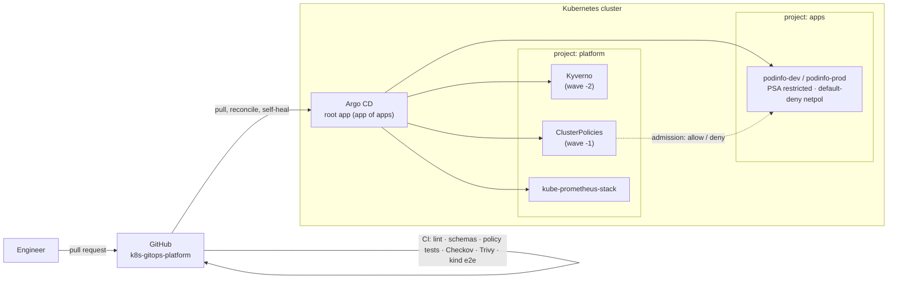

# k8s-gitops-platform

[](https://github.com/Z-mac-debug/k8s-gitops-platform/actions/workflows/ci.yml)

A GitOps-managed Kubernetes platform with **Argo CD** and **Kyverno**. Git is
the only way to change the cluster. Argo CD continuously reconciles the cluster
to match git and reverts manual drift. Kyverno admission policies stop insecure
or non-compliant workloads before they ever run.

CI does more than lint YAML. It creates a real Kubernetes cluster (kind),
installs Kyverno, deploys the app, and proves that a compliant workload is
admitted while a privileged pod, an untrusted registry and a `:latest` image are
all **rejected**.

## Architecture



## What's enforced

| Layer | Control |
|---|---|
| **Admission (Kyverno, Enforce)** | Pod Security Standards *restricted*: non-root, no privilege escalation, all capabilities dropped, RuntimeDefault seccomp, no host namespaces |
| | CPU/memory requests and a memory limit on every container |
| | Explicit image tag or digest; `:latest` rejected |
| | Images only from approved registries (`ghcr.io/z-mac-debug/*`, `ghcr.io/stefanprodan/*`) |
| | Liveness and readiness probes required |
| | Read-only root filesystem required |
| | `app.kubernetes.io/name` label required |
| | **Signed images only:** images from `ghcr.io/z-mac-debug/*` must carry a keyless cosign signature from the [secure-cicd-pipeline](https://github.com/Z-mac-debug/secure-cicd-pipeline) release workflow, and Kyverno pins the tag to the verified digest |
| **Namespace** | Pod Security Admission `restricted` labels (enforced by the API server itself), ResourceQuota (no LoadBalancers or NodePorts), LimitRange defaults |
| **Network** | Default-deny ingress and egress. podinfo accepts HTTP from its own namespace and metrics scrapes from `monitoring` only, and may only talk to DNS |
| **Workload** | Non-root UID 10001, read-only root FS, no service-account token, HPA, PodDisruptionBudget, zero-downtime rolling updates, topology spread |
| **GitOps (Argo CD)** | `apps` project: one source repo, `podinfo-*` namespaces only, an explicit allow-list of namespaced kinds, no RBAC or webhooks. Automated sync with prune and self-heal reverts manual changes |

The policies and the image-signing pipeline connect into one supply-chain
story: **secure-cicd-pipeline** builds, scans and signs the image, and this
platform refuses to run it unless that signature verifies.

## Repository layout

```
bootstrap/          # one-time: pinned Argo CD v3.6.1 + root app
projects/           # AppProjects: platform (cluster-wide) and apps (locked down)
clusters/dev|prod/  # app of apps: what runs on each cluster
platform/policies/  # Kyverno ClusterPolicies
apps/podinfo/       # base + dev/prod overlays (Kustomize)
tests/kyverno/      # policy unit tests: a compliant pod plus one pod per violation
tests/e2e/          # a pod that must be rejected on a live cluster
```

## CI pipeline

| Job | What it proves |
|---|---|
| Gitleaks | no secrets in git history |
| Lint, render & schema-validate | yamllint passes; every kustomization renders, and the output validates against Kubernetes and CRD schemas (kubeconform, strict) |
| Kyverno policy unit tests | every rule passes the compliant pod and fails exactly the pod that breaks it |
| Checkov / Trivy | the workload manifests and workflows pass two independent misconfiguration scanners |
| **End-to-end on kind** | Kyverno installs; the app is admitted, rolls out and answers health checks; a privileged pod from an untrusted registry is **rejected**; switching the Deployment to `:latest` is **rejected** |

Actions are pinned to commit SHAs, and Dependabot updates them after a 7-day cooldown.

## Try it locally

```bash
kind create cluster
helm install kyverno kyverno/kyverno -n kyverno --create-namespace --version 3.9.2 --wait
kubectl apply -k platform/policies
kubectl apply -k apps/podinfo/overlays/dev
kubectl apply -f tests/e2e/noncompliant-pod.yaml   # denied, with the reasons listed
```

Full GitOps mode:

```bash
kubectl apply -k bootstrap --server-side           # Argo CD + root app
kubectl -n argocd get applications                 # everything else syncs from git
```

Argo CD pulls from this repository, so it must be public, or you need to add a
read-only repo credential to Argo CD.

## Roadmap

- Pin images by digest, with Renovate keeping tags and digests current
- Argo CD ApplicationSets to generate per-cluster apps
- External Secrets Operator with AWS Secrets Manager
- Gateway API ingress with cert-manager TLS
- Deploy the signed `secure-cicd-pipeline` image as a second app
